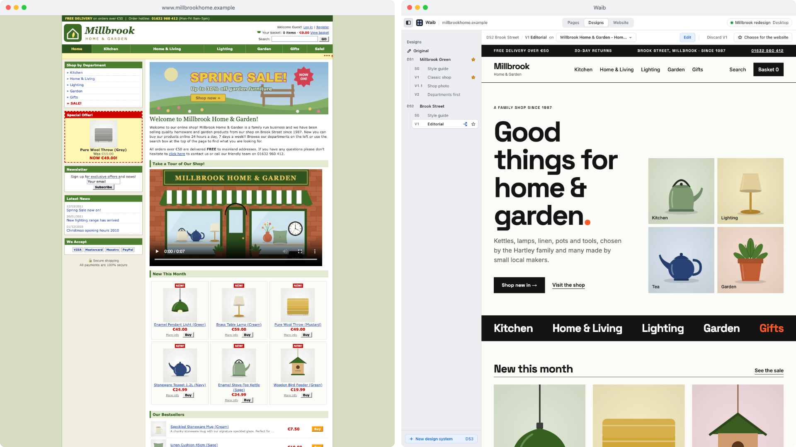
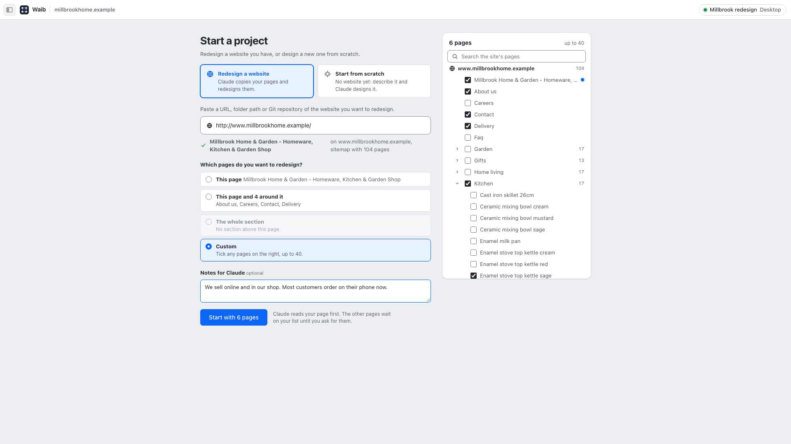
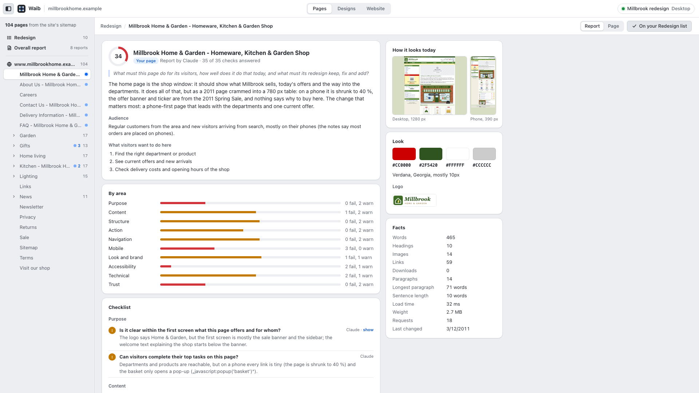
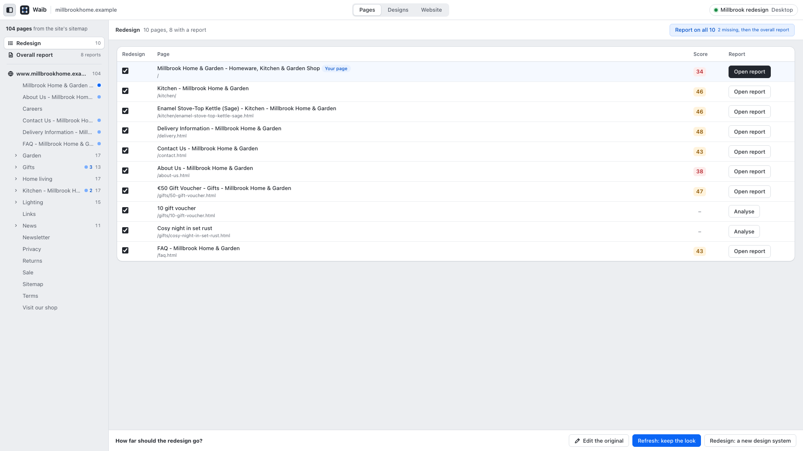
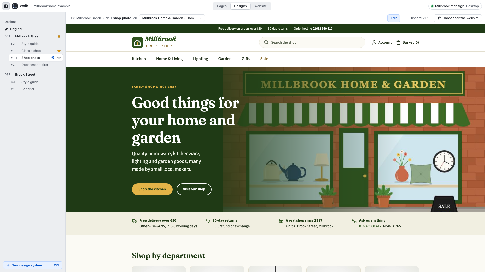
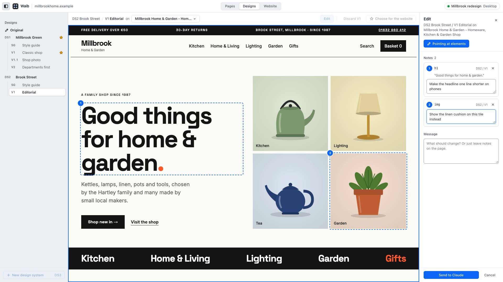
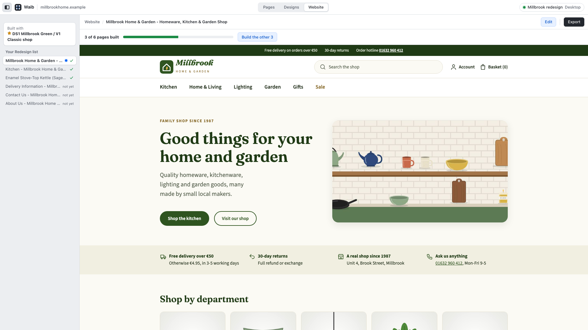
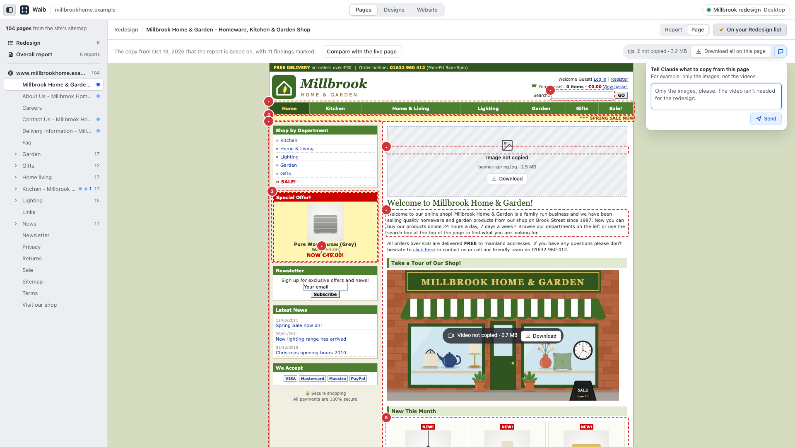

# Waib

**Redesign an old website with Claude Code, in a small app on your computer.**



## In short

- **What it does:** Waib copies the pages of your website, checks each one, and has Claude design new versions you can compare, comment on and export.
- **What you need:** [Claude Code](https://claude.com/claude-code) (2.1.224 or newer lets the app send requests to Claude directly; older versions copy them for you to paste), Python 3.9 or newer, macOS or Linux.
- **Install:** run `/plugin marketplace add ai41-MCK/Waib` and then `/plugin install waib@waib` in Claude Code.
- **Start:** run `/waib:waib https://your-website.com` in Claude Code. Any page of the site works, and so does the folder or Git repository of its code.
- **No website yet?** Run `/waib:waib` and choose **Start from scratch**.
- **Just looking?** Ask Claude to open the Waib example: a finished project for a made-up shop.
- **Licence:** free for any use ([0BSD](LICENSE)).

## Install

Pick one way.

**As a plugin** (easiest). In Claude Code:

```
/plugin marketplace add ai41-MCK/Waib
/plugin install waib@waib
```

Start it with `/waib:waib`. To update, run `/plugin marketplace update waib`, then update Waib under `/plugin` → Installed, and restart Claude Code. Remove it with `/plugin uninstall waib@waib`.

**From a clone** (to change Waib itself):

```bash
git clone https://github.com/ai41-MCK/Waib.git
cd Waib
./install.sh
```

Start it with `/waib`. Update with `git pull`, remove with `./uninstall.sh`.

The first start sets up a Python environment with a browser for taking screenshots. It takes about a minute, once. On Linux the browser may need extra system libraries; if screenshots fail, ask Claude to install them for Waib's browser.

## How it works

Claude opens the app in your browser. You click; Claude does the work. The app sends your requests to Claude Code, so you rarely have to type in the chat.

### 1. Pick your pages



Paste any page of your website, or the folder or Git repository of its code: Claude then starts the site on your computer. Waib reads the site's list of pages and shows them as a tree. Choose just your page, a few pages around it, a whole section, or tick the pages you want (up to 40). Add notes for Claude if you like: who visits the site, what has to stay, what bothers you. Later, in the Pages tab, you can add any page, a whole folder or the entire site with one tick, or just ask Claude in the chat.

### 2. Read what's wrong



Claude copies each page and checks it against a 35-point checklist: is it clear, is it current, does it work on a phone, can visitors act, is it accessible. Every finding comes with proof: a quote, a number or the spot on the page. The app shows the score, the checklist and the findings marked on the page. With two or more pages you also get an overall report with a recommendation and a brief for the new design.

### 3. Choose how far to go



Once Claude has read your page, a bar at the bottom of the Pages tab asks how far the redesign should go. It stays there until the first design exists.

- **Edit the original:** small fixes to the pages as they are.
- **Refresh:** keep the look, rebuild the rest.
- **Redesign:** a new look.

### 4. Compare designs



Claude builds the first design on your page. Every design has a style guide, and you can have several:

- **Design systems:** different looks, such as a refresh of the old brand and something completely new.
- **Layouts:** different page structures in the same look.
- **Sub-versions:** a copy of a layout to try one change next to the original (V1 → V1.1).

Switch between them with the arrow keys. Ask Claude to build a design on more pages from the page menu. Mark the one you like with ★.

### 5. Point at what to change



Press **Edit**, click anything on the page and write a note. Notes from several places go out together as one request, and Claude gets the exact element with each note. The page updates by itself when Claude is done.

### 6. Export



The **Website** tab shows the ★ design on all your pages and what's still missing. **Export** writes the finished pages into `export/`, ready to upload. Links to pages you didn't redesign go to your live site (for a site started from its code, they keep working as on your site).

## Try the example

The example is a finished Waib project for Millbrook Home & Garden, a made-up shop with an old website. It has eight copied pages with reports, two design systems with several layouts and style guides. Ask Claude "open the Waib example", and it downloads and opens it. To get it yourself, download [the example branch](https://github.com/ai41-MCK/Waib/archive/refs/heads/example.zip) and ask Claude to open that folder in Waib.

## Good to know

**Where your work goes.** Each project is a folder in the folder you started Claude Code in, named after the site (`waib-<domain>`), its code folder or repository, or `waib-scratch`. It holds the copied pages, the reports, the designs and the export. To come back to a project later, start Waib again with the same address, or ask Claude to open the project's folder.



**What gets copied.** Waib saves each page as your browser shows it, with its images, styles and fonts, but without its scripts. A page that builds itself with JavaScript may therefore look partly empty; the report says so when that happens. To keep projects small, Waib copies one size of each image and leaves out videos, the sound of audio players and images over 2 MB. Once a project's copies hold 50 MB of images, further images are left out too. These show as placeholders of the same size, each with a **Download** button. **Download all on this page** gets the rest, and the chat button next to it lets you tell Claude what you want, such as "only the images".

**Safety.** The app runs only on your computer and opens with a private link, so other users of the computer can't use it. A copied page can't reach your computer or local network, and it may load files only from the site itself and from popular, well-known sites (such as Google Fonts or YouTube). For any other site the app asks you once; your answer counts for all your projects. A site started from its code runs on your computer, so its copies aren't limited this way.

**Which Claude session gets your requests.** The badge at the top right shows it. Every Claude Code session that opened the app for this project is listed, so you can keep separate topics in separate chats. Without a running session, the app copies each request for you to paste.

**Shortcuts.** In Designs, ← → switch design systems and ↑ ↓ switch versions. On the Website tab, ↑ ↓ go through the pages. Click a selected name again to rename it, like renaming a file.

**When the app stops.** It keeps running in the background and stops by itself after 10 minutes with no open page and no running session. Claude starts it again when you ask.

## For contributors

```
skills/waib/SKILL.md         the workflow Claude follows, and the messages from the app
skills/waib/checklist.json   the report checklist: questions, how to judge them, weights
scripts/
  setup_venv.sh              builds or repairs .venv (runs at every start; instant when ready)
  app.py                     the local app: server, sessions, messages to Claude
  site_index.py              the site's pages: its sitemap, or the links around a page
  scrape_site.py             copies pages with Playwright, with placeholders for left-out media
  analyze.py                 page text, facts and measured checks; --verify checks a report
  measure.py                 renders a copy at desktop and phone width: screenshots and checks
  manage_variants.py         design systems and layouts, the edited original, media, export
  common.py                  shared helpers
  trusted_hosts.txt          well-known sites a copy may load from without asking
templates/app.html           the app's page
install.sh / uninstall.sh    install from a clone
.claude-plugin/              plugin and marketplace manifests
```

The browser that takes the screenshots (Playwright's Chromium) is shared with other projects and never deleted automatically. It lives in `~/Library/Caches/ms-playwright` on macOS and `~/.cache/ms-playwright` on Linux. Your answers about which other sites copies may load from are kept in `~/.claude/waib/hosts.json`; uninstalling leaves both in place.

## Licence

[Zero-Clause BSD](LICENSE): use, copy, change and sell it, for any purpose, without asking and without naming the author.
